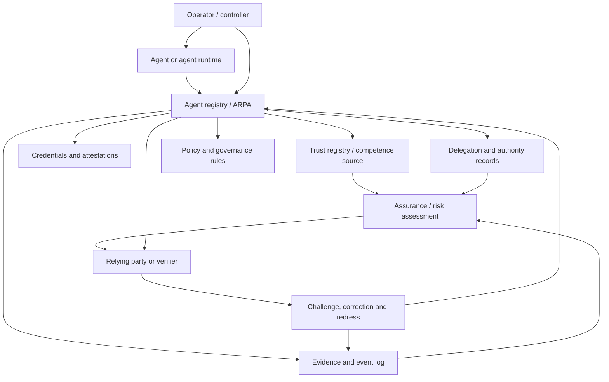

# Agent governance reference architecture

This document describes the broader architecture in which ARPA sits. It is informative. It does not create new protocol requirements.

## Architectural thesis

A governed agent ecosystem requires more than an agent identifier and a discovery endpoint. It requires a control plane that can bind agent identity, operator accountability, delegated authority, lifecycle state, evidence, policy and redress into an inspectable reliance surface.

ARPA provides the registry layer of that control plane.

## Layer model

## Component responsibilities

| Component | Responsibility | ARPA role |
|---|---|---|
| Agent or runtime | Performs or proposes action | Subject of registration and lifecycle state |
| Operator / controller | Controls or operates the agent | Accountable party linked to registry records |
| Agent registry | Publishes governed agent state | Core ARPA concern |
| Delegation records | Establish scoped authority | Referenced, validated or projected by ARPA |
| Credentials / attestations | Carry claims about parties, capabilities or status | Inputs to authority and assurance decisions |
| Trust registry | Defines competence, recognition or trust source status | External competence input, not replaced by ARPA |
| Policy and governance rules | Define admissible behavior and relying-party constraints | Referenced by registry and conformance profiles |
| Evidence and event log | Retains material state transitions and proofs | Core ARPA evidence concern |
| Assurance / risk assessment | Evaluates reliance quality | Consumer of ARPA evidence, not automatically produced by ARPA |
| Redress path | Supports challenge, correction and remediation | Governance requirement surfaced by ARPA |

## Key separation rules

1. **Discovery is not authority.** Finding an agent record does not prove that the agent is authorized for the requested action.
2. **Registration is not delegation.** A registry entry can bind identity and lifecycle state without granting task authority.
3. **Delegation is not enforcement.** A delegated permission may exist even when runtime enforcement has not converged.
4. **Registry state is not certification.** ARPA evidence can support assurance but does not by itself certify safety, legality or suitability.
5. **Historical reconstruction is not current authority.** Requested-time reconstruction must disclose later material events and reconstruction quality.
6. **Federation is not trust inheritance.** A record imported from another registry must preserve competence, provenance and conflict semantics.

## Architectural interfaces

| Interface | Primary question |
|---|---|
| Agent ↔ Registry | Which agent is registered and under what lifecycle state? |
| Operator ↔ Registry | Who is accountable for creating, updating or retiring this record? |
| Registry ↔ Delegation | What authority is claimed, bounded, revoked or expired? |
| Registry ↔ Trust Registry | Which source is competent to assert recognition or registry status? |
| Registry ↔ Evidence | Which events, proofs and checkpoints support a decision? |
| Registry ↔ Assurance | What evidence can an assessment process consume? |
| Registry ↔ Relying Party | What can the verifier safely rely on now, and with what caveats? |
| Registry ↔ Redress | How can an affected party challenge, correct or audit a record? |

## Lab use

This architecture gives the laboratory a map for experiments. A proposed experiment should identify which interface it stresses, what failure mode it examines and what evidence would change the architecture or the protocol.

## Current ARPA coverage

ARPA currently has strongest coverage for:

- identity and discovery;
- lifecycle state;
- authority and delegation boundaries;
- evidence and event semantics;
- historical reconstruction;
- API and event contracts;
- conformance vectors;
- A2A and TRQP integration boundaries.

It has intentionally incomplete coverage for:

- independently operated deployments;
- cross-organization federation at scale;
- formal certification or legal assurance;
- runtime safety enforcement inside arbitrary agent frameworks;
- universal AI-governance obligations.

Those gaps are not defects by themselves. They are the lab's next experimentation surface.
