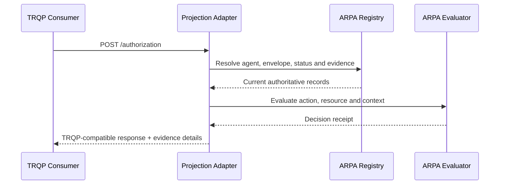
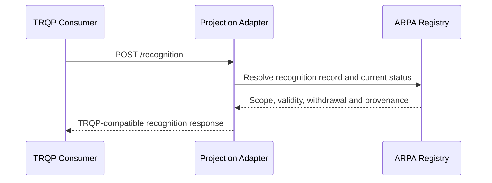

# ARPA–TRQP Interoperability Architecture

**Status:** Informative companion to ARPA Candidate v0.10.0  
**Profile:** `arpa-trqp-query-projection-0.1`

## Purpose

ARPA and TRQP address different layers of a trust-registry system. ARPA governs agent identity, relationships, delegated authority, recognition, lifecycle state, evidence, events, enforcement convergence, federation, and redress. TRQP provides a minimal, read-only interface for asking authorization and recognition questions of an authoritative system of record.

The integration is therefore a **governed query projection**, not protocol adoption, merger, derivation, or transfer of normative authority.

```text
ARPA records + lifecycle + policy + evidence
                  |
                  v
       ARPA–TRQP projection adapter
                  |
                  v
      TRQP authorization / recognition
```

## Authority boundary

| Concern | ARPA responsibility | TRQP-facing responsibility |
|---|---|---|
| State creation and mutation | Defines registration, delegation, suspension, revocation and recognition lifecycle | None; query only |
| Authorization | Evaluates bounded authority, status, conditions and prohibitions | Returns a portable answer derived from current authoritative state |
| Recognition | Stores scoped, time-bound and withdrawable recognition | Returns whether one authority recognizes another for an action and resource |
| Evidence | Retains source records, receipts, event history and proofs | May expose references in response details |
| Discovery | Publishes registry capabilities and optional endpoint metadata | Uses a declared endpoint; no mandatory registry-of-registries is inferred |
| Conformance | ARPA profiles and evidence | Separately declared TRQP endpoint/consumer conformance |

ARPA conformance does not imply TRQP conformance. TRQP conformance does not imply ARPA conformance.

## Authorization sequence



An affirmative response is prohibited when authority is expired, revoked, suspended for the requested operation, outside delegated scope, stale where freshness is required, unsupported, or materially conflicting.

## Recognition sequence



Recognition is explicit, scoped, non-transitive by default, and does not transfer authority. Technical federation does not imply governance recognition.

## Historical/as-of projection

ARPA v0.9.4 makes historical authority resolution explicit. When a TRQP-facing query carries a requested time, an ARPA projection SHOULD preserve the distinction between the requested historical time and the later evaluation time, resolve ARPA state at the requested time, and retain current-state/later-event context in ARPA evidence where the TRQP response surface cannot carry it directly.

A projected affirmative historical result MUST NOT be interpreted as a claim that the subject remains authorized or recognized now. Likewise, a later revocation, compromise, supersession, or recognition withdrawal MUST NOT silently rewrite historical ARPA state unless an applicable governance rule or authoritative event declares retroactive effect.

The projection adapter MUST disclose information loss where TRQP cannot carry ARPA's reconstruction status, selected record versions, later material events, retention boundary, or evidence-integrity status. ARPA and TRQP conformance remain independently declared.

## Lifecycle projection

| ARPA state | Query class | Required interpretation |
|---|---|---|
| `active` | Affirmative only when all other checks pass | Current evidence required |
| `suspended` | Negative | Temporary inactivity must be visible |
| `revoked` | Negative | Revocation evidence retained |
| `expired` | Negative | Validity window ended |
| `unknown` | Indeterminate | No reliable state available |
| `conflicting` | Indeterminate | Conflict must not be resolved optimistically |
| `unavailable` | Indeterminate | Source failure is not affirmative trust |

## Discovery declaration

An ARPA registry may publish an optional `trqp` capability block containing endpoint, version, query types, projection profile, governance profile and security profile. This is an ARPA interoperability declaration. It is not a mandatory TRQP discovery architecture.

## Information loss

TRQP core answers cannot carry the full ARPA delegation path, conditions, prohibitions, lifecycle history, enforcement acknowledgements or redress context. The mapping therefore records information loss and includes evidence references in response details where supported.

## Conformance and assurance

The repository validates the mapping, safety rules, positive and negative vectors, two independent projection implementations, networked endpoint behavior, durable event handling and evidence reproducibility. The current normative ARPA source baseline is Candidate v0.10.0; this TRQP document remains an informative interoperability companion. These results demonstrate the supplied candidate implementation package only. They do not constitute certification, legal recognition, universal interoperability, or formal approval by the TRQP project.


## Machine-readable operation relationship (informative)

The version-pinned declaration in [`interop/protocol-operation-relationships.json`](../../interop/protocol-operation-relationships.json) records two `projects-to` relationships: ARPA authority evaluation to TRQP 2.0 authorization, and ARPA recognition resolution to TRQP 2.0 recognition. Run `python3 scripts/validate_protocol_operation_relationships.py` to check uniqueness, protocol versions, direction, explicit non-transfer of authority, information-loss disclosure, historical/current separation, and independent conformance declarations. `make validate` includes this check; `make test` exercises negative mutations.

The declaration is an **inventory and assertion about mapping intent**, not an alternate normative interface, a runtime policy engine, or evidence that a TRQP endpoint is conformant. The validator checks declared invariants; runtime adapter behavior and semantic fidelity require the existing TRQP projection tests and network interoperability evidence.

### Why `projects-to` rather than `carries`

A Trust Tasks-style carrier preserves an externally owned operation inside a different interaction envelope. The ARPA adapter instead computes an ARPA-governed determination and projects a bounded result into TRQP. Consequently, the adapter must account for semantic information loss and may not treat a syntactically valid TRQP answer as proof of underlying authority.

Three separately assessable properties remain:

1. **Source correctness:** ARPA resolved authoritative records, delegation, lifecycle, freshness, constraints, and historical effects correctly.
2. **Projection fidelity:** the adapter preserved the meaning of the resulting determination, including indeterminate and information-loss cases.
3. **Consumer interpretation:** a relying party can identify what was determined, the temporal scope, provenance, and limitations; it must not infer current authority from an affirmative historical answer.

A passing relationship-declaration validator proves none of these three properties by itself.

### A2A comparison and abstraction decision

A2A publication is a discovery/publication projection, and A2A task completion is not ARPA authorization. TRQP projection exposes authorization or recognition determinations whose authority, freshness and information-loss characteristics are more consequential. Both integrations require typed boundaries, but **their runtime and outcome semantics differ**.

**Decision: defer a portfolio-wide or protocol-wide relationship framework.** The two existing integrations do not justify introducing a generic adapter runtime, dynamic relationship registry, common outcome schema, or new core protocol requirement. Retain protocol-specific profiles and validators. Revisit only if a third independently implemented adapter exposes repeated, testable relationship contracts that cannot be maintained economically within existing profiles.

### Limits and evolution

The relation keys and source-operation labels are informative identifiers within this local declaration, not newly registered ARPA protocol operations. No guarantee of external TRQP approval or independently established conformance follows from this document. Changes to Candidate v0.10.0 or TRQP 2.0 require explicit compatibility reassessment; do not silently retarget the mapping. This work does not modify the published IETF Internet-Draft or ARPA's runtime authority evaluator.
