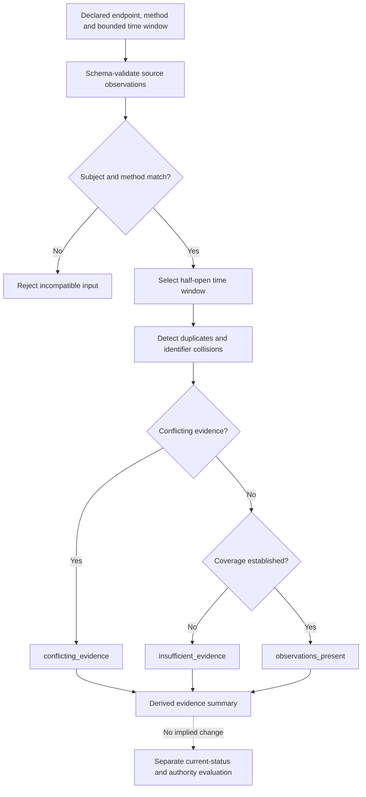
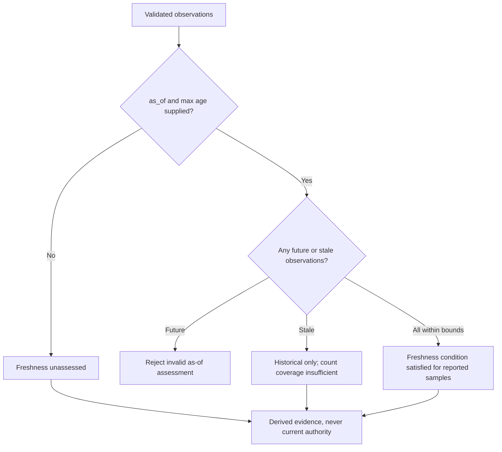
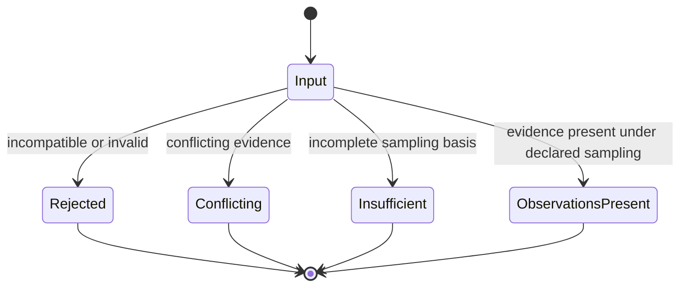

# Longitudinal operational evidence assessment (experimental)

This optional, **informative** assessment is tracked under [#98](https://github.com/qbf-consulting/agent-registry-protocol/issues/98). It consumes the [observation evidence profile](operational-observation-evidence.md) introduced in #97. It is not authoritative ARPA status, assurance, reputation or permission, and does not amend the Candidate Specification or IETF Internet-Draft.

## Processing flow

## Boundaries and interpretation

Window selection uses `start <= observed_at < end`, with offset-aware timestamps. Duplicate observation identifiers with identical bytes are deduplicated; conflicting representations using one identifier cause rejection. Observations must concern the same subject and method; incompatible methods are not aggregated.

The evidence count and outcome counts describe **observations only**. `observations_present` never means uptime, readiness or authorization. The declared expected count is a caller-provided sampling assumption, not evidence that probes actually occurred. `coverage.complete` is therefore an *input-based coverage claim*, not an independently verified continuous-monitoring guarantee. A missing sampling schedule, insufficient samples, duplicate submissions, indeterminate outcomes or unperformed probes cannot yield complete coverage under this experimental profile.

Conflicts are detected conservatively for opposite success/failure outcomes at the same timestamp from different evidence items; different observation times may reveal operational change rather than disagreement. A different observer perspective can explain apparent differences, and no automatic observer trust ranking occurs. The evaluator does not authenticate observers, retrieve referenced evidence, validate digests, apply expiry, or incorporate later security or revocation events. A generated summary must not override those independent decisions.

## Freshness and coverage qualification

The optional `as_of` and `max_observation_age_seconds` inputs bound the freshness of each observed timestamp. An observation after `as_of` is rejected; stale observations are retained as historical evidence but cannot satisfy the declared sampling-coverage condition. The resulting `freshness` metadata reports what was evaluated, not current service availability. Without explicit freshness inputs, `freshness.evaluated` is false and downstream reliance must not infer freshness.

`coverage.basis` is `declared_count_only`: the value `coverage.complete` refers only to satisfaction of a declared count under the modeled input rules. It **does not** establish uninterrupted monitoring or independently verified observation coverage. A production relying party must establish the sampling schedule and evidence integrity independently.

## Outcome diagram

These are evaluation results, **not operational agent lifecycle transitions**.

## Validate

Run `python3 scripts/validate_operational_assessment.py`. For a report: `python3 scripts/validate_operational_assessment.py --output artifacts/operational-assessment/validation-report.json`.

The modeled fixture set verifies ordering, duplicate handling, missing coverage, conflicting observers, wrong methods, invalid windows and observation-identifier collisions. It does not provide independent runtime or production assurance.
