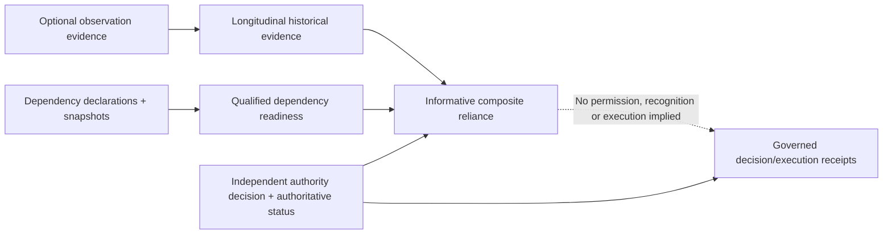

# Operational observation, dependency and reliance: evidence disposition

**Status:** Informative acceptance and compatibility review for [#96](https://github.com/qbf-consulting/agent-registry-protocol/issues/96), incorporating child issues #97–#100. This is **not** a new normative conformance profile, production certification, signed attestation, or modification of Candidate Specification v0.10.0 / IETF draft -04.

## Architecture and reading order

The bounded implementation layers are [individual observation evidence](operational-observation-evidence.md), [longitudinal summaries](longitudinal-operational-evidence.md), [dependency evidence and snapshots](operational-dependency-readiness.md), [integrated reliance](operational-reliance-interoperability.md), and [structural receipt reference checks](operational-receipt-binding.md). Their tests run under the repository release checks. See [A2A integration](a2a-registry-integration-guide.md), [authority non-amplification](authority-non-amplification.md), and [operational resilience](operational-resilience.md) for independent source semantics.

## Evidence traceability

| Requirement / boundary | Executable evidence | Demonstrated | Not demonstrated |
|---|---|---|---|
| #97 observation structure, non-authority | `scripts/validate_operational_observations.py`, `conformance/test-vectors/operational-observation/` | Schema and negative fixture checks | Observer authentication, independent evidence retrieval |
| #98 historical windows, deduplication, conflict, as-of freshness | `scripts/validate_operational_assessment.py`, `conformance/test-vectors/operational-assessment/` | Deterministic modeled summary and declared count-only coverage | Verified continuous monitoring, independently recognized observers, disclosure enforcement |
| #99 dependency structure, cycle policy, temporal validity, snapshot mismatches | `scripts/validate_operational_dependencies.py`, `conformance/test-vectors/operational-dependency/` | Bounded deterministic model; mismatch yields indeterminate | Trusted current snapshot retrieval, cross-registry competence/recognition and actual event-driven invalidation |
| #100 separate authority/status/operations dimensions | `scripts/validate_operational_reliance.py`, `conformance/test-vectors/operational-reliance/` | Fourteen modeled integration vectors, including revoked authority despite positive observations | Independently established identity and authority, live multi-registry reliance |
| #100 Python/TypeScript composition parity | `scripts/validate_reliance_cross_runtime.py`, `typescript/src/operational-reliance-conformance.ts` | 13 of 13 shared modeled composition results and reason codes matched in CI | Independent TypeScript implementation of the observation and federation stack |
| #100 existing execution receipt boundary | `scripts/validate_operational_receipt_binding.py`, `conformance/test-vectors/operational-receipt-binding/` | Nine modeled structural consistency checks | Signature verification, real execution evidence, independent authority/revocation verification |

Existing `make release-check`, `make typescript-check`, `make rust-check`, `make cross-runtime`, `make network-interop`, and `make pages-check` gates provide repository-owned regression/publication evidence. Success on these gates must not be reported as external interoperability or operational certification.

## Source authority, profile status and compatibility

All observation, longitudinal, dependency and integrated reliance documents are **optional informative experiments**. They do not alter the ARPA `relationship`, `status`, `execution_receipt`, A2A, authority-decision or normative lifecycle contracts. A caller may ignore them without a migration. The existing Relationship Record requires an `authority_source`; operational dependencies deliberately remain separately modeled because service reliance is not delegation. The new TypeScript comparison covers composition only. The normative Candidate Specification remains v0.10.0 and the published IETF revision remains -04.

The experimental schemas identify `profile_version: 0.1.0` and require a separately justified decision before normative promotion. In particular, `coverage.complete` is declared-count sufficiency **only**, and the `registry_context.recognized` flag is an input claim, not independently authenticated federation competence. A digest alone does not prove the freshness of a snapshot supplied by an untrusted party. A composite outcome of `prerequisites_observed` is never authorization.

## Reproduction and evidence limitations

Run `make release-check-all` using the repository's documented setup; the bounded focused commands are listed in the respective guides. The generated `artifacts/operational-reliance/evidence-report.json` and cross-runtime reports are repository-managed output, not a signed production evidence statement.

Independent reproduction would require an implementation outside repository control, authentic federation evidence, explicitly resolved current authority and lifecycle status, a verified observation provenance and sampling basis, and proof-bound execution receipts. Until those exist, **the corresponding original #98–#100 acceptance boxes must remain unchecked**. Their closure requires either fulfilling them with evidence or explicitly changing their scope through a separately reviewed governance decision; a parent close must not silently erase them.

## Release disposition

**Release candidate significance:** The accumulated optional schemas, examples, validators and integration tests are materially consumable and may warrant a future implementation/conformance release. **Decision: release not yet warranted under #96** until the project determines the versioned experimental-profile compatibility promise, resolves the remaining original acceptance criteria or approves formal deferral, and verifies the release head and published documentation. There is no normative Candidate v0.10.0 or IETF draft bump implied by these changes.

## Residual work and closure condition

Continue to track independent source competence, privacy-limited evidence, trusted freshness, two-registry interoperability, third-party reproduction and proof-bound action receipts in their existing child issues or approved successor issue(s). #96 can close only when those acceptance gates are evidenced or formally dispositioned without claiming that missing evidence has passed.

## Bounded closure and successor tracking

See the [experimental reproduction and acceptance guide](operational-assurance-reproduction.md) for the clean-checkout commands, modeled versus independent evidence distinctions, and the approved limited-scope closure basis. Independent operational provenance and federation remain tracked by [#113](https://github.com/qbf-consulting/agent-registry-protocol/issues/113), and actual action-specific execution receipt assurance by [#114](https://github.com/qbf-consulting/agent-registry-protocol/issues/114). An unchecked original acceptance criterion is **transferred**, not passed.
