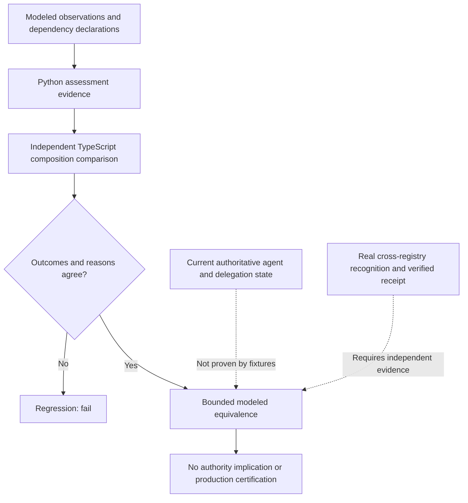

# Reproducing the operational-assurance experiment

This guide is the bounded **experimental implementation** closeout for #96 and its children #98–#100. It does not document a live two-registry pilot, current authorization proof, production execution, or third-party certification.

## Reproduce from a clean checkout

Use the repository's documented Python, Node and Rust dependencies. From the repository root run:

```bash
make setup
make validate
make typescript-check
make rust-check
make cross-runtime
make network-interop
make pages-check
```

Alternatively `make release-check-all` runs the governed release checks. The command suite depends on installed runtimes and the repository's toolchain guidance; the checks are also performed by GitHub Actions. Do not infer that this document itself executes the commands or proves third-party reproduction.

Bounded evidence entry points are `conformance/test-vectors/operational-assessment/v0.1.0.json`, `conformance/test-vectors/operational-dependency/v0.1.0.json`, `conformance/test-vectors/operational-reliance/v0.1.0.json`, and `conformance/test-vectors/operational-receipt-binding/v0.1.0.json`. Output includes `artifacts/operational-assessment/validation-report.json`, `artifacts/operational-dependency/validation-report.json` and `artifacts/operational-reliance/`. The current TypeScript comparison is **composition-only**: its observation and dependency dimensions originate in Python.

## Reproduction boundaries



**IR-01, IR-07 and IR-09** in #100 have modeled analogues but cannot be represented as independently verified live identity, federation or A2A invocation tests. Receipt reference consistency is not cryptographic validation. A privately disclosed observation is schema-valid but access-control enforcement is not established by the model.

## Acceptance disposition

For the original #96 tranche, the user authorized a **bounded closure scope**: accept modeled optional experimental implementation separately from production and independently verified assurance. The original checkboxes remain historical requirements; unmet requirements must not be checked merely because they were transferred. The two independent obligations have explicit successor tracking:

- [#113](https://github.com/qbf-consulting/agent-registry-protocol/issues/113): independent observation provenance, privacy and cross-registry recognition.
- [#114](https://github.com/qbf-consulting/agent-registry-protocol/issues/114): real decision and execution receipt assurance.

This is not a normative specification amendment. Closing #96 and its children on an **accepted bounded scope** does not close #113 or #114 and does not claim that their acceptance criteria passed.

## Release disposition

The new profiles are informative experimental artifacts and do not change Candidate v0.10.0 or IETF draft -04. Release decision is separate and must follow `docs/release-policy.md` and the checked source commit, with compatibility and limitations stated explicitly; no release/version is implied by issue closure.
