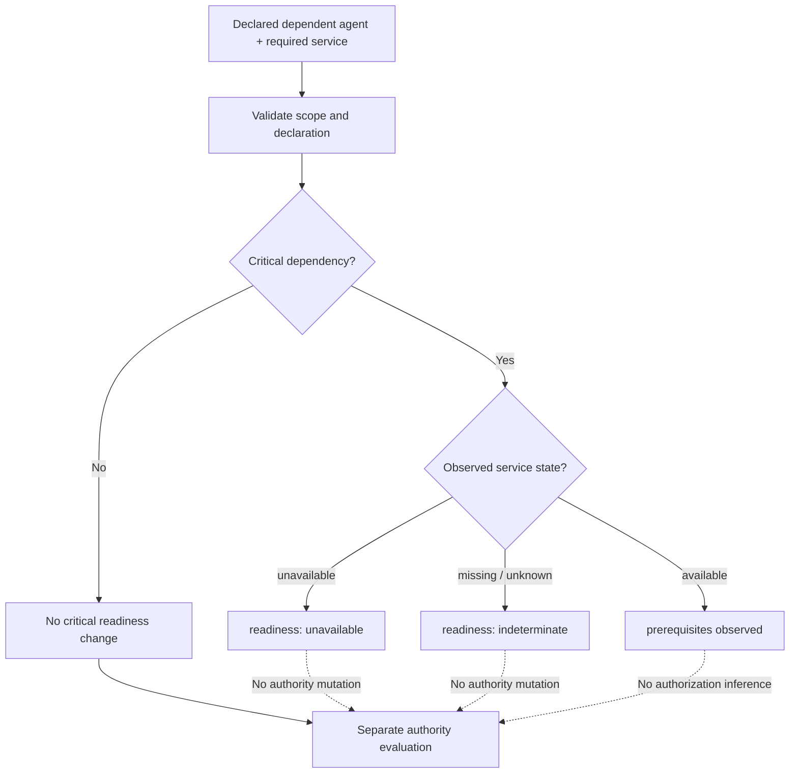
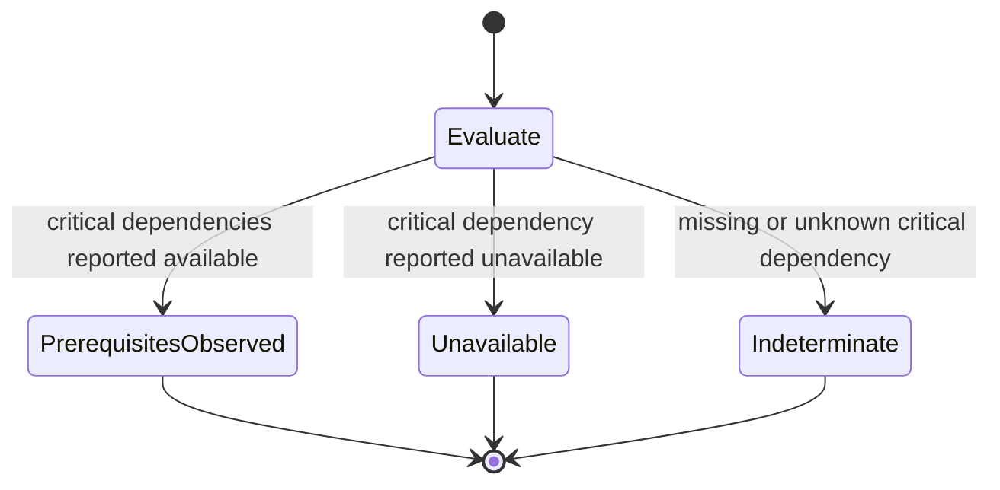

# Operational dependency readiness (experimental)

This optional prototype supports [issue #99](https://github.com/qbf-consulting/agent-registry-protocol/issues/99). It is **not** an amendment to ARPA v0.10.0, a recognized delegation, an authority-bearing Relationship Record or an assertion about production readiness.

ARPA's existing [Relationship Record](../schemas/relationship.schema.json) requires `authority_source`. Operational service dependencies are not necessarily relationships of authority. Rather than misusing that required field or broadening normative enum values prematurely, the [optional dependency declaration](../schemas/operational-dependency.schema.json) remains separate until integration evidence justifies consolidation.

## Dependency evaluation flow

## Dependency result state diagram

These are derived evaluation outcomes, not changes to an agent's lifecycle, authorization or status.

## Boundaries

A reported `available` state is merely an evaluator input; the modeled fixture set does not authenticate its source or determine whether it is fresh. `prerequisites_observed` is therefore not a current-readiness guarantee, and the absence of declared critical dependencies does not certify an agent's operational health.

A dependency must never imply `delegates_to`, authority transfer, invocation permission, recognition, assurance or trust propagation. No topology policy, cycle detection, multiple-observer conflict resolution, federation recognition or temporal-validity enforcement is claimed by this initial prototype. Those are necessary acceptance and interoperability questions for #99 before closure.

Run `python3 scripts/validate_operational_dependencies.py` for the preliminary modeled fixtures. Full status/authority composition belongs to [#100](https://github.com/qbf-consulting/agent-registry-protocol/issues/100).
