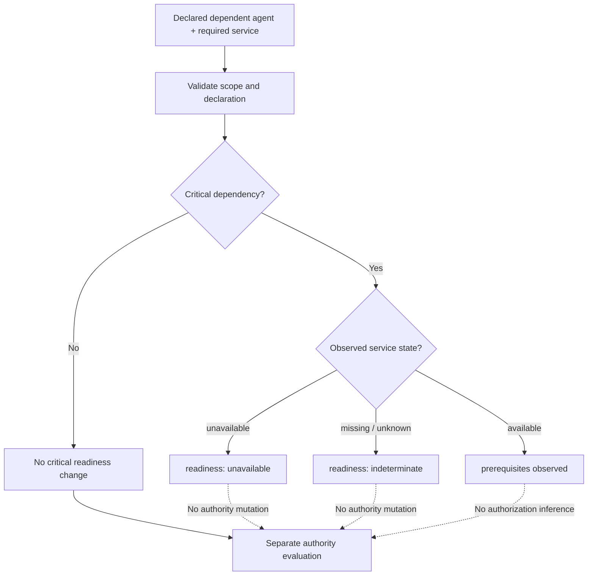
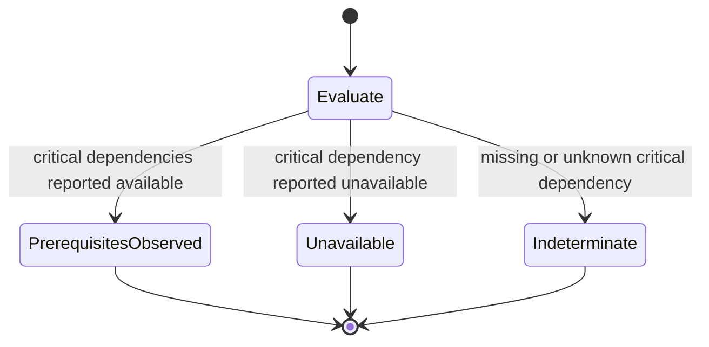
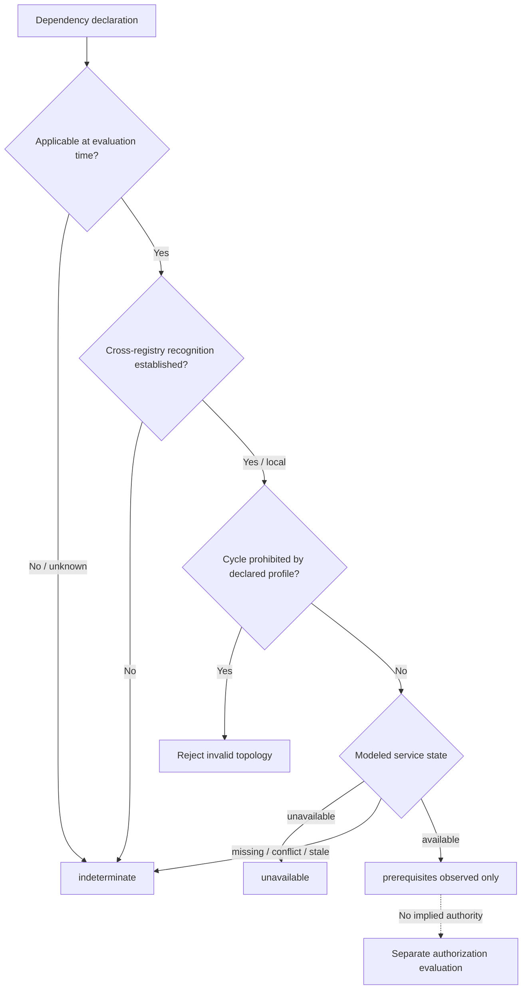
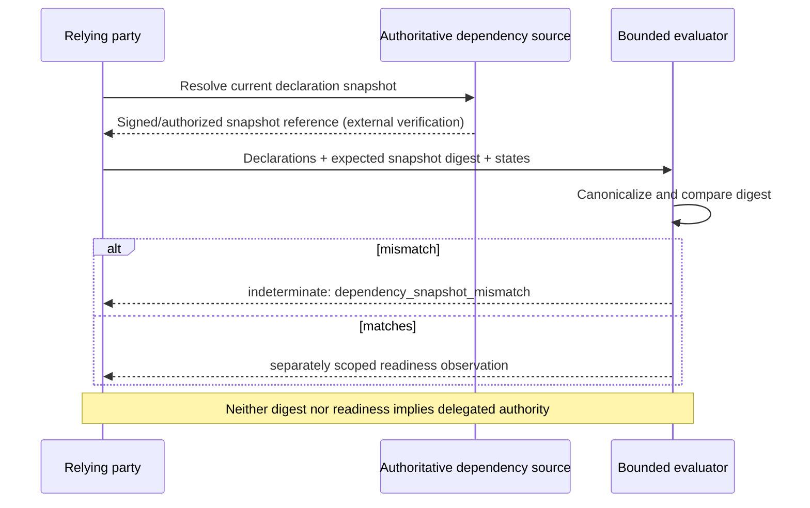

# Operational dependency readiness (experimental)

This optional prototype supports [issue #99](https://github.com/qbf-consulting/agent-registry-protocol/issues/99). It is **not** an amendment to ARPA v0.10.0, a recognized delegation, an authority-bearing Relationship Record or an assertion about production readiness.

ARPA's existing [Relationship Record](../schemas/relationship.schema.json) requires `authority_source`. Operational service dependencies are not necessarily relationships of authority. Rather than misusing that required field or broadening normative enum values prematurely, the [optional dependency declaration](../schemas/operational-dependency.schema.json) remains separate until integration evidence justifies consolidation.

## Dependency evaluation flow

## Dependency result state diagram

These are derived evaluation outcomes, not changes to an agent's lifecycle, authorization or status.

## Temporal and federation evaluation

## Dependency snapshot binding

The evaluator now emits a SHA-256 `snapshot_digest` over canonicalized dependency declarations sorted by `dependency_id`. A relying assessment can supply an `expected_snapshot_digest`; a mismatch yields `indeterminate` with `dependency_snapshot_mismatch`, never affirmative readiness. This prevents reuse of a known old declaration snapshot after a material declaration change **when the consumer supplies a trusted expected digest**. The evaluator does not establish that the reference digest is trusted or up to date; obtaining it remains a separate authoritative resolution requirement.

A changed snapshot is detectable only when the expected digest has been obtained from a trusted current resolution context. A digest produced solely by the same untrusted source as the supplied declarations cannot independently establish freshness or provenance; relying implementations must preserve the verification result separately.

## Boundaries

A reported `available` state is merely an evaluator input; the modeled fixture set does not authenticate its source or determine whether it is fresh. `prerequisites_observed` is therefore not a current-readiness guarantee, and the absence of declared critical dependencies does not certify an agent's operational health.

A dependency must never imply `delegates_to`, authority transfer, invocation permission, recognition, assurance or trust propagation. The bounded evaluator now checks declared applicability intervals against an explicit evaluation time, rejects inverted intervals, detects cycles under an explicit `prohibit` profile, and preserves `permit` cases without making a universal DAG requirement. Conflicting modeled state inputs produce an indeterminate result. A cross-registry dependency is not accepted as a satisfied prerequisite unless its `registry_context.recognized` input is explicitly true. **That input is a modeled recognition assertion, not independent verification of federation competence.** No real registry querying, observer verification, topology versioning, freshness-proof evaluation, or event-based invalidation is implemented. These remain limitations requiring independent integration evidence before #99 can be closed.

Run `python3 scripts/validate_operational_dependencies.py` for the preliminary modeled fixtures. Full status/authority composition belongs to [#100](https://github.com/qbf-consulting/agent-registry-protocol/issues/100).
