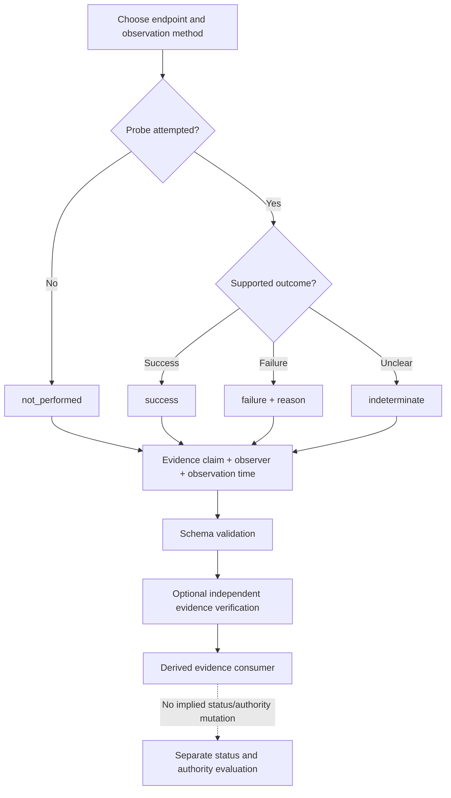
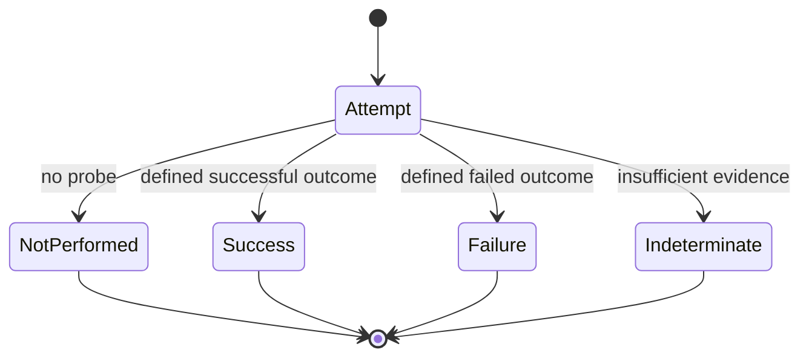

# Operational observation evidence

**Experimental, optional profile for issue #97.** Not part of the normative ARPA v0.10.0 Candidate Specification or the published IETF draft.

ARPA's [Service Endpoint](../schemas/service-endpoint.schema.json) and [Status](../schemas/status.schema.json) records already describe the operational state. The [observation evidence schema](../schemas/operational-observation.schema.json) instead describes a particular observer's reported measurement of a particular endpoint. It is not a new authoritative record family. A self-reported or independently reported observation does not by itself establish observer competence, recognition, assurance, action permission, current operational readiness or future availability.

## Evidence processing flow

## Single-attempt state diagram

This state diagram describes an observation attempt, **not** an ARPA agent lifecycle or status transition. Each subsequent measurement creates a separate observation.

## Interpretation boundaries

| Method | What success can establish | What it cannot establish |
|---|---|---|
| `transport_probe` | Transport condition held at observation time | A2A protocol validity |
| `protocol_probe` | Declared protocol interaction succeeded | Task authority, task completion |
| `endpoint_control_proof` | Declared endpoint control procedure succeeded | Institutional recognition, delegation |
| `other_declared_method` | Only declared method's tested condition | Any stronger untested claim |

An observation is a provenance-bound **claim**. Evidence digests bind referenced bytes only if independently checked. Schema validation does not authenticate the observer or cryptographically verify its evidence. `failure` from one vantage point is not necessarily authoritative service unavailability. `indeterminate` and `not_performed` must not be counted as success.

`observed_at` is distinct from the optional `issued_at`. Historical evidence remains usable for permitted historical analysis without asserting current state. Repeated reports must not be counted as independent successful observations without appropriate deduplication and evidence verification. `disclosure_class` is advisory metadata; actual access restrictions belong at the host's enforcement boundary. Minimize correlated endpoint/observer identifiers and infrastructure disclosures.

## Validate

Run `python3 scripts/validate_operational_observations.py` for the positive and negative [fixtures](../conformance/test-vectors/operational-observation/v0.1.0.json). Use `--output artifacts/operational-observation/validation-report.json` to generate a reproducible fixture report. This tests schema and expected invalid representations only; it is **not** proof of live operational availability, independent security review or interoperability. Future [#98](https://github.com/qbf-consulting/agent-registry-protocol/issues/98) may aggregate observations; [#100](https://github.com/qbf-consulting/agent-registry-protocol/issues/100) will test composition with ARPA reliance evaluation.
