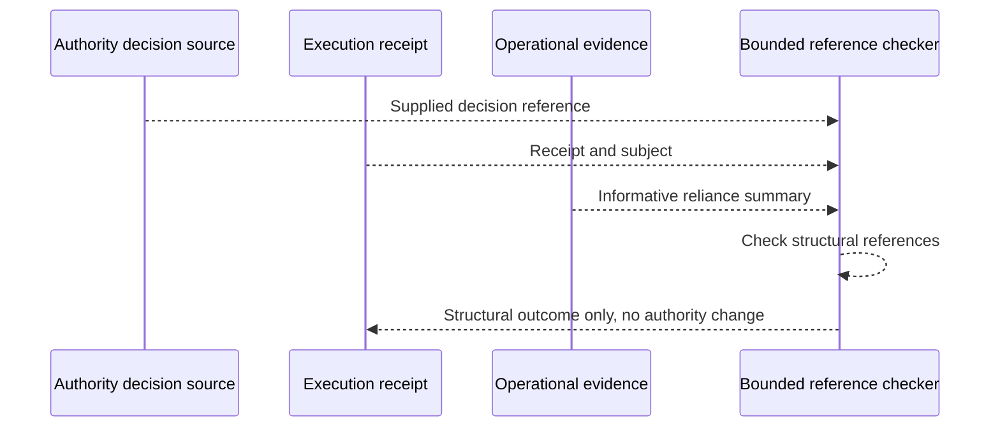

# Operational reliance and execution receipt references

This informative experiment for #100 checks that the existing execution receipt's `authority_decision_receipt` points to a supplied decision record and that the subject and result are structurally consistent. It does not authenticate, sign or issue an execution receipt, verify actual authority, or establish a production action occurred.

Run `python3 scripts/validate_operational_receipt_binding.py`. Negative fixtures include decision-reference mismatch, identity mismatch, success with denied authority, and operational evidence claiming authority. **A structurally consistent receipt is not proof of a valid signature, current authorization, authoritative policy, or actual execution.** The broader #100 execution-receipt assurance checkbox must remain unchecked until those external boundaries are tested.
