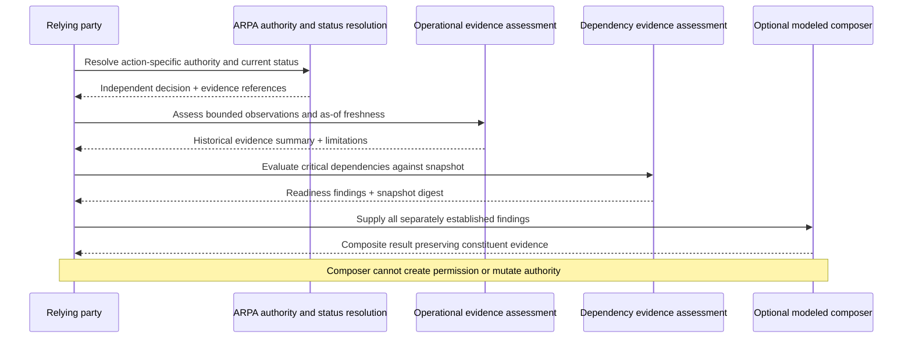
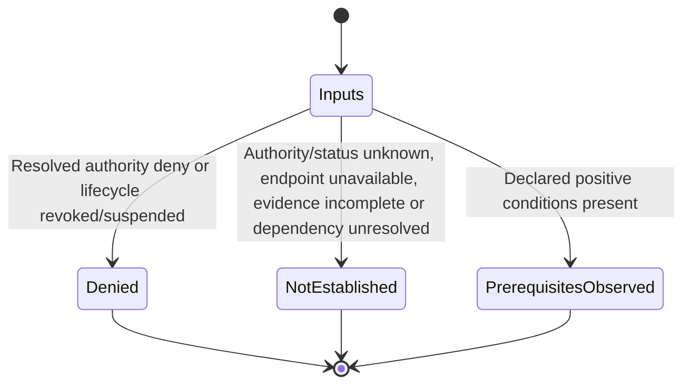

# Operational reliance interoperability (experimental)

This **informative, modeled integration** implements part of [#100](https://github.com/qbf-consulting/agent-registry-protocol/issues/100), using the [operational evidence assessment](longitudinal-operational-evidence.md) and [dependency readiness profile](operational-dependency-readiness.md). It does not change ARPA Candidate v0.10.0 or the published IETF Internet-Draft. It is **not** an authorization endpoint, an execution receipt, a certification of availability or independent cross-registry conformance evidence.

## Two separate determinations

The caller supplies an *already resolved* authority decision with its evidence reference, an authoritative status snapshot with its evidence reference, bounded operational observations and dependency declarations. ARPA’s actual authority resolution, status precedence and revocation behaviour remain owned by their established machinery. This integration validates the shape and separation of the reported findings; it **does not itself establish** that the supplied authority or status references are authentic, current or competent.



## Evaluation outcome states



**Crucial:** `prerequisites_observed` is not `permit`. It does not authorize an action, attest current operational readiness, or establish that the underlying evidence sources have been independently verified. No observed availability can override a revoked authorization. A federated record with `recognized: true` is merely a modeled input unless independently checked by the relying party.

## Run the integration vectors

```bash
python3 scripts/validate_operational_reliance.py
# Evidence report: artifacts/operational-reliance/evidence-report.json
```

The fixture set includes valid declared conditions, revoked authority, critical dependency failure, stale observations, conflicting observers, unknown and federated dependencies, history after revocation, discovery without permission, changed dependency snapshots, revoked lifecycle despite a permit input, omitted freshness evaluation, offline endpoint and malformed authority provenance.

Expected findings are asserted for both overall outcome and independently reported reason, status, evidence and dependency dimensions. These are **repository-owned modeled fixtures**, not evidence of a deployed three-agent/two-registry environment, independently executed A2A traffic, or external interoperability. External conformance and actual receipt binding remain outstanding acceptance considerations for #100.

## Compatibility and migration

The optional schema `schemas/operational-reliance-result.schema.json` and test evaluator are additive. Existing A2A publication, authority envelope, decision and execution-receipt schemas are unchanged; applications are not required to support this experiment. Source freshness and snapshot recognition must be resolved by competent external components before consequential reliance.

## Evidence report

The validator writes a deterministic machine-readable report containing individual modeled scenario IDs, expected outcomes, observed outcomes, pass/fail results and explicit evidence limitations. Re-running against the same fixtures produces equivalent content. A PASS describes repository-owned modeled fixture evaluation, not cryptographic verification, actual enforcement or independent cross-runtime interoperability. The report is an implementation-test artifact and does not bind a production execution receipt.

## Cross-runtime composition comparison

TypeScript independently implements the **final composition gate**, consuming bounded dimensions prepared by Python from modeled observation and dependency fixtures. The check compares outcome, reason codes and the non-authority marker, and it does **not** establish independent TypeScript observation validation, federation resolution or authority source verification.

```bash
python3 scripts/validate_reliance_cross_runtime.py --prepare
cd typescript && npm run operational-reliance && cd ..
python3 scripts/validate_reliance_cross_runtime.py --compare
```

The output reports in `artifacts/operational-reliance/` are repository-owned modeled assurance evidence. An operational reliance result is **not** an execution receipt and must never substitute for the authoritative action-specific decision receipt referenced by `schemas/execution-receipt.schema.json`.
